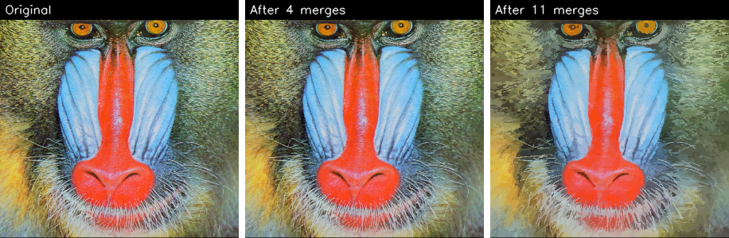

# Image Segmentation by Region Unification

A C++ image-segmentation demo that iteratively merges neighboring regions with similar colors. The code implements labeling, adjacency construction, and merging. OpenCV handles image I/O and the interactive display.



## Algorithm

1. Scan the image in raster order. A pixel inherits an adjacent label from above or to the left when the colors agree. Otherwise it starts a new region.
2. Build region adjacency by checking the right and lower neighbors of each pixel for label changes.
3. For each merge round, choose the adjacent region with the nearest mean color, reconcile the labels, and recalculate region colors and pixel counts. Cache each merge level for display.
4. Render the result by assigning every pixel the mean color of its region.

The label image uses `CV_32S`. Region colors are represented with `Vec3f`.

## Build and run

The original build uses Windows, Visual Studio (MSVC x64), and OpenCV 4.12. Build with CMake and run from the repository root so `images/baboon.jpg` can be found.

```sh
cmake -S . -B build
cmake --build build --config Release
```

Run `./build/region_unification` for a single-configuration build or `.\build\Release\region_unification.exe` for a Visual Studio Release build. Use the **merge** slider to browse the cached levels. Press **S** to save the current result or **Esc** to exit.

[MIT License](LICENSE)
